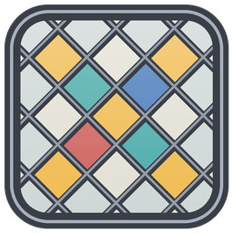

<p align="center"></p>

# Leadlight

Shader packs on Apple silicon Macs, through [Metallum](https://modrinth.com/mod/metallum-mc)'s
Metal renderer. Leadlight runs OptiFine-format packs (Photon, Complementary, BSL, Sildur's, Solas,
Noble, Bliss, MakeUp, ...) **unmodified**, picked and configured the way you would under Iris.

Leadlight is built on [Vitrail](https://github.com/avpbynf/Vitrail-Shaders) by avpbynf, which does
the same thing on Minecraft's own Vulkan renderer. Vitrail's pack loader, GLSL translator, uniform
catalogue, frame schedule and settings screen are used here; what Leadlight changes is the layer
underneath, where the engine talks to the GPU, so that it talks to Metallum's Metal backend instead.
Leadlight is an independent project and is not affiliated with or endorsed by the authors of Vitrail,
Metallum, Iris or OptiFine.

## Requirements

| Component | Version |
| --- | --- |
| Minecraft | 26.2 |
| Fabric Loader | 0.19.3 or later, with Fabric API |
| Metallum | 0.0.24 (exactly: Leadlight hooks Metallum's internals) |
| Sodium | 0.9.x |
| Mac | Apple silicon (M1 or later) |

## Install

1. Put `leadlight-<version>.jar` in `mods/` next to Metallum, Sodium and Fabric API.
2. Leave **Video Settings > Graphics API** on its default, which Metallum labels **Prefer Metal**.
3. Put shader packs in `shaderpacks/` as usual, and pick one on the **Leadlight** page of the video
   settings, or with the `I` key. `K` turns shaders off and on, `R` reloads the pack from disk.

Remove Iris and Vitrail from the same instance: Iris draws on OpenGL only, and Vitrail on Vulkan
only. Leadlight refuses to load next to Vitrail.

Pack settings are stored next to the pack (`shaderpacks/<pack>.zip.txt`), in the file Iris uses for
the same pack, so settings carry over from Iris. Leadlight's own files are in `leadlight/` in the
instance folder.

## Works with

Distant Horizons (far terrain reaches the pack), Continuity with connected-texture and PBR resource
packs such as Patrix, and Entity Texture Features / Entity Model Features with Fresh Animations.

## What Leadlight changes from Vitrail

Everything the engine did through Vulkan is done through Metal here:

- **Backend.** Draws when the game runs on Metallum's Metal backend, instead of Vulkan, and sets the
  graphics API back to Metal (not Vulkan) after a startup that crashed.
- **Compute shaders.** A pack's compute programs (Photon's sky lighting and light propagation,
  Complementary's floodfill) are cross compiled to MSL kernels and dispatched on Metal compute
  encoders, in Metallum's own encoder order.
- **Custom images and storage buffers** (`image.*` and `bufferObject.*` directives) are Metal
  textures (1D, 2D, 3D, viewable in other formats) and Metal buffers, bound by name in render
  passes and computes, cleared and moved with Metal blit commands.
- **Colour targets a compute writes** (`colorimgN`) are created shader-writable.
- **Mip chains** are filled with Metal's blit `generateMipmaps`.
- **Hardware shadow comparison** uses a Metal comparison sampler.
- **Distant Horizons** is told Metal is not OpenGL. It names only Vulkan and OpenGL, and on Metal
  took the OpenGL road, whose lightmap hook casts the game's texture to an OpenGL one and stopped the
  game at the loading screen; it now draws through Blaze3D as it does under Vitrail on Vulkan, and
  its far terrain reaches the pack.
- **Resource-pack normal and specular maps** are uploaded one whole mip level at a time. One upload
  per sprite and level, as on Vulkan, costs Metallum a staging copy and a blit encoder each; with
  Continuity over a pack like Patrix that was tens of thousands in one command buffer, which the GPU
  failed as out of memory, leaving the game stuck on the Mojang screen. Failed Metal command buffers
  are now logged, as is a failure in the startup step Minecraft runs without reporting one.
- **Entity pipelines** are evicted from Metallum's cache when the pack's vertex layout changes, and
  the live pack's pipelines are kept across resource reloads, as Vitrail does with Vulkan's.

And Metallum itself is extended where a shader pack needs more than the game does:

- up to **8 colour targets** per pass (Metallum 0.0.24 attaches one), with pipeline variants for
  passes that attach a different set;
- **sampler slots numbered per stage**, and samplers baked into the shader past Metal's sixteen;
- fragment outputs padded to the target's components, which Metal requires;
- **1D and 3D sampled textures**;
- shaders compiled as **MSL 3.1** whatever Java runs the game (Metal otherwise picks the version
  from the SDK the `java` binary was built with, MSL 3.0 for the launchers' Zulu runtimes);
- GLSL comments stripped with a real scanner instead of two regular expressions, which cut pack
  code in half wherever a line comment held a `/*`.

## Fixes over Vitrail

These were bugs in Vitrail on Vulkan as well, fixed in Leadlight:

- **Flickering, yellow emissive layers with Entity Texture Features** (Fresh Animations' glowing
  spider eyes, any `_e` texture). ETF draws its emissive layer immediately, while the game is drawing
  solid entities, with a translucent render type. Vitrail only took translucent entity draws in
  its translucent window, so it handed these to the game's own shader, which drew them unjittered
  and already tone mapped into the game's picture; that showed through the pack's TAA-jittered body
  on some frames and came out yellow. Such draws now go through the pack's translucent entity
  program at the moment they arrive, as Iris does.
- **Glowing eyes (`gbuffers_spidereyes`)** now read the same per-draw model-view matrix as the body
  they are drawn over, and the shaders are compiled with Metal's `preserveInvariance`, so the overlay
  and the body land on the same depth.

- **Invisible water with Noble.** Noble's water stage hands `gl_FragDepth` to its shadow lookup
  without ever writing it. OpenGL leaves the depth alone in that case, but once compiled to SPIR-V
  the builtin is an output and the unwritten value failed the depth test, so no water was drawn. A
  stage that reads `gl_FragDepth` and never writes it now reads `gl_FragCoord.z` instead.


## Not supported (yet)

- **Geometry shaders.** Metal has no geometry stage. As on a Vulkan device without one, a geometry
  stage that only passes vertices through is folded away and any other program is refused.
- **Background shader compilation.** Vitrail compiles the families a pack draws later (entities,
  particles, ...) ahead of time on Vulkan only; here they compile on their first draw, which can
  cost a short hitch the first time each appears.
- **Pass timings** (`-Dleadlight.passTimings`): Metallum has no GPU timestamps.

## Tested

On an M4 Max, macOS 27, Metallum 0.0.24, Sodium 0.9.2: Photon v1.3b (default settings and with
coloured lights), Complementary Reimagined r5.9.3 (default and with coloured lighting), BSL 10.1.8,
Sildur's Vibrant 2.02 Extreme, Solas 3.7b, Noble 1.9.9, Bliss 2.1.2 and MakeUp UltraFast 9.5g, in
the Overworld, Nether and End, day and night, on a recent JDK and on the Modrinth launcher's Zulu 25;
Photon and BSL with Entity Texture Features 7.2.6, Entity Model Features 3.3.12 and Fresh Animations
1.10.5 with its Extensions and Player packs; Photon with Distant Horizons 3.3.3; Photon with Continuity 3.0.1 and Patrix 32x.

## Building

Needs JDK 25.

```bash
./gradlew build
```

The jar is written to `build/libs/`. `./gradlew runClient` starts a development client with
Metallum, Sodium and Fabric API. For unattended checks, `-Dleadlight.debugScript=<file>` runs a
list of steps once a world is on screen (see `dev/DebugScript.java`).

## Credits and licence

Leadlight is by OhJey. It is a modified version of Vitrail by avpbynf, and is distributed under
the same licence, the GNU Lesser General Public License version 3 only: see [LICENSE](LICENSE) and
[GPL-3.0.txt](GPL-3.0.txt). [NOTICE](NOTICE) says what was changed from Vitrail and credits the
material Vitrail reuses from Iris and other projects. The complete source of every release is in this
repository.

Vitrail's own documentation is kept in `docs-upstream/`. It describes the Vulkan engine Leadlight
is built on, and most of it applies unchanged.

Metallum is by kokodio (MIT). Leadlight depends on it and does not include it.
